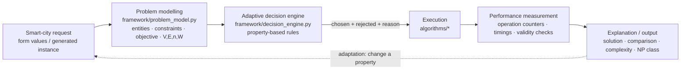

# Architecture



```text
┌──────────────┐   ┌─────────────────┐   ┌──────────────────┐   ┌────────────────────┐   ┌───────────────┐
│ 1 INPUT      │──▶│ 2 PROBLEM MODEL │──▶│ 3 DECISION ENGINE│──▶│ 4 EXECUTE+MEASURE  │──▶│ 5 EXPLANATION │
│ goal + props │   │ entities        │   │ rule on          │   │ run chosen AND the │   │ solution      │
│ (no algo     │   │ constraints     │   │ properties:      │   │ alternative;       │   │ comparison    │
│  names)      │   │ objective       │   │ density, divisi- │   │ count ops, time,   │   │ time/space    │
│              │   │ size V,E,n,W    │   │ bility, storage, │   │ cross-check        │   │ NP-Hard/-Compl│
│              │   │                 │   │ n sites, ratio   │   │ correctness        │   │ rejected + why│
└──────────────┘   └─────────────────┘   └──────────────────┘   └────────────────────┘   └───────────────┘
```

## Decision catalogue (every rule is a property test)

| Goal | Property tested | Rule | Alternative rejected |
|---|---|---|---|
| connect_sites | modelled cost: `2V²` vs `E·log₂E` | Prim-matrix if `2V² < E·log₂E`, else Kruskal | the other one |
| all_pairs | every pair needed | Floyd–Warshall | repeated single-source runs |
| budget_projects | `divisible` | Fractional (greedy) / 0/1 (DP) | the other + ratio-greedy |
| city_records | `storage` | disk → B-Tree, memory → Red-Black | the other |
| maintenance_priorities | decrease-keys per event, n | ≥ 1 and n ≥ 1000 → Fibonacci, else Binomial | the other |
| sensor_placement | pairwise row/col/diagonal conflicts | N-Queen backtracking | brute-force placement |
| inspection_tour | number of sites n | ≤ 8 backtracking; 9–13 branch & bound; > 13 refused | the other / exact search |
| route_feasibility | feasibility only, no cost | Hamiltonian backtracking | TSP |
| matrix_chain | associative product, mixed dimensions | DP on split point | left-to-right order |

## Adaptation cases shown on the `/adapt` page

1. Sparse vs dense graph → Kruskal vs Prim (matrix)
2. Indivisible vs divisible budget → 0/1 DP vs Fractional greedy
3. Disk vs memory → B-Tree vs Red-Black Tree
4. Small/few escalations vs large/many escalations → Binomial vs Fibonacci
5. 6 sites vs 10 sites vs 16 sites → Backtracking vs Branch & Bound vs refusal (NP-Hard limit)
